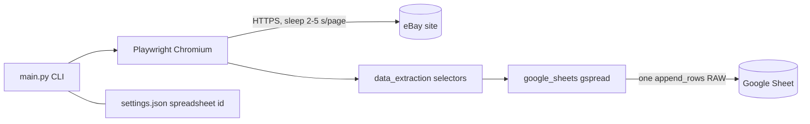

# System design review: LaptopLoot

Existing-system mode. Stack, flow and known bugs: see [logic-map.md](logic-map.md) (verified 2026-11-05); fixes: [plans/2026-11-05-logic-map-fixes.md](plans/2026-11-05-logic-map-fixes.md). Not repeated here.

## Assumptions

| Number | Value | Label |
|---|---|---|
| Kind | one-shot CLI (`python main.py`), no server, no DB, no cache | measured (logic-map.md "Entry points") |
| Users | 1 (the author), run by hand | assumed |
| Runs/day | ~1 | assumed |
| Commit history | 27 commits; feature work ended 2024-05-27; since 2026-10-16 only dependency/CVE bumps and the 2026-11-05 fix pass | measured (git log) |
| Local logs / DB / data dirs | none in repo; state is only `settings.json` (72 B, one spreadsheet id) | measured (ls, cat) |
| Pages per run | up to 20 (`--pages` unset = all) | assumed |
| Listings per page | ~50 | assumed (eBay default, not confirmed live) |
| Row size | 7 fields, ~0.5 KB | assumed |
| Per-listing scrape cost | ~100 ms (about 20 CDP round trips: 7 `locator.all()` plus `text_content` per element) | assumed |
| Per-page fixed cost | 3.5 s mean sleep (`randint(2,5)`, `web_scraping.py:155`) + ~2 s load | measured (code) + assumed |

## 0. What exists

Single process: Playwright Chromium (visible, `headless=False` by default) drives eBay, then one `append_rows` call writes to a Google Sheet via gspread (async). No web server, queue, cron or deploy: it runs on the author's desktop. Rung today: **below rung 1** (a script, not a service). Numbers below treat it as a batch job.

## 1. Requirements

One sentence: scrape eBay laptop listings for one query and append them to a Google Sheet.

- Functional: query + filters, scrape all pages, append rows. Out of scope: dedup, price history, alerts, multi-user.
- Non-functional (assumed): latency irrelevant (minutes per run is fine); availability n/a (manual run); durability: rows must not be silently lost or duplicated; consistency n/a; security: service-account key via `SERVICE_ACCOUNT_FILE`, sheet permissions; observability: logs only.

## 2. Napkin math

Run 1: 5 pages x 1 run/day. Run 2: full run, 20 pages x 50 listings = 1000 rows/day (script call counts rows as requests).

```
$ napkin.py --dau 1 --req-per-user 1000 --peak 1 --write-kb 0.5 --read-share 0 --retention-years 5
  requests/day ............ 1.0k   (average 0.0 req/s)
  writes at peak .......... 0.0 req/s, shards 1, replicas 0
  per year ................ 547.5MB (x3 repl, not applicable: one sheet)
  after 5 years ........... 2.7GB (overstated, see below)
verdict: rungs 1-2: one good VPS. Ship it.
```

Hand-checked with python: 1000 rows x 7 cells = 7000 cells/run; Google Sheets cap is 10M cells per spreadsheet, so 10M / 7000 = ~1430 daily full runs (~4 years at 1 run/day). Wall time per run: 20 x (3.5 s sleep + ~2 s load + 50 x 0.1 s) = ~210 s (assumed inputs).

Load is nowhere near any server limit. The binding constraints are external: eBay anti-bot behaviour and Sheets API quotas, not our CPU or storage.

## 3. API contract

n/a. The contract is the CLI: see logic-map.md "Entry points". Idempotency: none (every run appends again).

## 4. Architecture

Rung 0 is correct; nothing should be added.



- Playwright: eBay has no public listing feed here; a real browser is the way in.
- Sheet: the user's chosen UI and storage; at 7000 cells/run it is adequate.
- `settings.json`: only persisted state (one id).

## 5. Data

Engine: a Google Sheet used as an append-only table. No header row, no key, no dedup (logic-map.md step 11). Access pattern is "append a batch, read by eye", which a sheet serves. A key (item id from the URL) would let a re-run skip existing rows; today every run duplicates. Cache: none, none needed (the data is the output).

Sheet limits that matter: 10M cells, and the 5M/10M-cell grid is allocated by `resize_worksheet`, whose grid-vs-filled logic is in logic-map.md step 11.

## 6. Scale and failure

- x10 traffic (10 queries/day or 200 pages/run): scrape time ~10x (about 35 min per day) and eBay bot detection arrives first, long before any local resource saturates. Sheets cap reached in ~143 days of full runs.
- Slow upstream (eBay 8 s): `networkidle` waits default 30 s elsewhere, but pagination uses 2 s (`web_scraping.py:154`), so a slow page ends the run early with partial rows, silently (logic-map #6).
- Sheets API down or quota hit: the exception is logged, rows are lost (they live only in memory), exit code 1 (fixed 2026-11-05). No retry, no local spool (see Risks).
- Process dies mid-scrape: all scraped rows lost, since the one write happens after the last page.
- Single machine is the single point of failure; acceptable for a hand-run tool.
- Retries/backoff/circuit breaker: none. Backups: the sheet is Google's; no local copy.

## 7. Trade-offs

- All-at-end write: simple and one API call (cheap on quota), costs durability of a long run.
- Sheet instead of DB: zero ops and easy to read, costs dedup, types and the 10M-cell cap.
- Headed browser: easier to debug and less detectable, costs it cannot run unattended or on a server.
- Silent exit 0: convenient for manual use, costs any chance of scheduling it safely. Fixed 2026-11-05: failures exit 1.

## 8. Summary

Design: a one-shot Playwright scraper writing one batch to a Google Sheet; right-sized, one user, ~1000 rows/day at most.
Would change if wrong: unattended or scheduled runs (needs non-zero exit codes, retries, headless, dedup); several queries per day (needs eBay rate care first); rows becoming data to analyse (move to SQLite).
Next rung: SQLite file as source of truth plus sheet export, triggered when the sheet nears ~5M cells (~700 full runs) or when the run is first scheduled.

## Risks

- HIGH: all rows held in memory and written once at the end; any crash, a Sheets error (logged, exit 1) or eBay block mid-run loses the whole scrape. `main.py:42-52`, `modules/google_sheets.py:107`. Related: logic-map #8.
- MEDIUM: no dedup or key, each run appends duplicates; sheet grows toward the 10M-cell cap (~1430 full runs). `modules/google_sheets.py:107`. Related: logic-map #7.
- MEDIUM: pagination stops on a 2 s `networkidle` timeout, silently truncating results and skipping the clicked page. `modules/web_scraping.py:154`. Related: logic-map #6.
- MEDIUM: anti-bot exposure: fixed pattern of 2-5 s sleeps, no backoff on block/captcha pages, no retry; placeholder items are saved as rows. `modules/web_scraping.py:155`. Related: logic-map #14.
- LOW: per-element CDP round trips (~20 per listing) make scrape time scale with listings; irrelevant at 1000 rows but sets the x10 runtime. `modules/data_extraction.py:51-67`.
- ✅ LOW: exit code 0 on any failure blocks safe scheduling. Fixed 2026-11-05: `main` returns 1, `sys.exit` passes it on.
